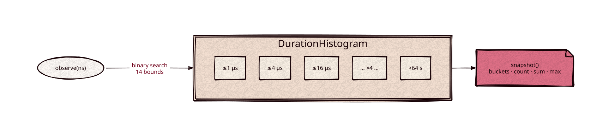

# metrics

Part of [Kronuz C++ Libraries](https://github.com/Kronuz/cpp-libraries), a collection of small, reusable C++ libraries.

[](https://github.com/Kronuz/metrics/actions/workflows/ci.yml)
[](LICENSE)


Bounded counters and duration histograms for C++20, header-only, with no dependencies.
Counters saturate instead of wrapping, and nothing allocates.



## ✨ Highlights

- `kronuz::metrics::Counter`: a single-owner `std::uint64_t` counter. `add(n)` saturates at
  the maximum instead of wrapping; `observe_max(v)` keeps the largest value seen.
- `kronuz::metrics::AtomicCounter`: the same with relaxed atomics, for counters several
  threads update. Every update is one compare-exchange on one word, so `add` and
  `observe_max` are each atomic and can be mixed.
- `kronuz::metrics::ContendedCounter`: for counters many threads `add` to. Two words (16
  bytes): amounts below 2^32 take one `fetch_add`, so an add never retries. The value is
  exactly as saturating as `AtomicCounter`'s.
- `kronuz::metrics::DurationHistogram<Counter>`: nanosecond durations in 15 buckets with
  inclusive bounds from 1 µs to 64 s, growing by 4× (the last bucket holds everything
  above 64 s), plus the count, the saturating sum, and the maximum.
  `AtomicDurationHistogram` uses `AtomicCounter` and `ContendedDurationHistogram` uses
  `ContendedCounter`. `snapshot()` copies the state out as a plain `DurationSnapshot`.

Nothing allocates, and an update is a few instructions: the bucket index is a branchless count
over 14 constant bounds.

## 📦 Installation

Requires a C++20 compiler; CMake 3.14 or newer for the CMake route. CI builds it on
Linux (x86_64, arm64), macOS (arm64, x86_64), and FreeBSD, plus ASan, UBSan, and TSan
builds.

```cmake
include(FetchContent)
FetchContent_Declare(metrics
  GIT_REPOSITORY https://github.com/Kronuz/metrics.git
  GIT_TAG        main)
FetchContent_MakeAvailable(metrics)

target_link_libraries(my_app PRIVATE metrics::metrics)
```

## 🚀 Quick start

```cpp
#include "metrics.hh"

kronuz::metrics::DurationHistogram<> latency;
latency.observe(12'000);                 // 12 µs
auto s = latency.snapshot();             // s.buckets, s.count, s.sum_ns, s.maximum_ns
```

## 🛠️ Building and testing

```sh
cmake -S . -B build && cmake --build build && ctest --test-dir build
./build/metrics_bench
```

## 🎯 When to use it

- ✅ Hot-path counters and latency histograms with fixed memory.
- ❌ Exporting: snapshots are plain structs; formatting for Prometheus or similar is yours.

## ⚡ Contended counters

Under contention the compare-exchange loop of `AtomicCounter` retries, and the retries cost
more than the add. A `fetch_add` never retries, but a bare `fetch_add` cannot saturate: if it
runs after another thread has lifted the same word to `UINT64_MAX`, the sum wraps. So no
`fetch_add` is added to a single word.

`ContendedCounter` splits the value over two words and returns their saturating sum:

- `small_` takes every add below 2^32 with one `fetch_add`, but only after loading a value
  below 2^63. Once it first reaches 2^63 each thread adds to it at most once more, so with
  `n` adds in flight it stays below 2^64 while `n <= 2^31`.
- `large_` takes every other add, and `observe_max`, with a clamping compare-exchange.

Each word only grows and neither wraps, so the value is exactly the saturating sum, a
reader never sees it decrease, and once it reads `UINT64_MAX` it reads `UINT64_MAX` forever.

It is 16 bytes and costs more than `AtomicCounter` where there is no contention to remove (two
threads on arm64; see Performance). Use it with `add` or with `observe_max`, not both:
`observe_max` maximizes `large_` only.

Both counters are templates on the word and the atomic (`BasicAtomicCounter<Word, Atomic>`,
`BasicContendedCounter<Word, Atomic>`); `AtomicCounter` and `ContendedCounter` are the 64-bit
`std::atomic` instances.

The histogram bucket index is the count of bounds below the value, a branchless loop.

## ✅ Verification

`test/model.cc` runs the counter code itself, at 8 bits, against a model atomic in which every
load, store, `fetch_add` and compare-exchange is one step. It explores every interleaving of two
to four threads of adds, `observe_max` and `get()` from initial states around the thresholds, and
checks that the value never decreases, that it stays between the saturated totals of the finished
and the started operations, that each `get()` returns a value from between its first and last
step, and that the final value is exact. It also rejects seven broken counters, among them a
single-word `fetch_add` fast path. `test/differential.cc` checks both counters at 64 and 16 bits
against a frozen compare-exchange counter, including small adds racing a large one with a
reader, and runs under ThreadSanitizer.

## 📊 Performance

ns per `add(1)` per thread, every thread adding to one counter, best of 5 (a shared host,
two readings each):

| | 2 threads | 4 threads | 8 threads |
|---|---|---|---|
| `AtomicCounter`, Apple M4 Pro | 5.3, 5.5 | 64.4, 68.0 | 322, 340 |
| `ContendedCounter`, Apple M4 Pro | 7.4, 7.5 | 32.3, 32.8 | 161, 169 |
| `AtomicCounter`, Intel i9-9980HK | 60.6, 66.6 | 223, 268 | 591, 782 |
| `ContendedCounter`, Intel i9-9980HK | 36.9, 45.5 | 86, 90 | 187, 187 |

A bare `fetch_add` with no saturation costs 6.5 ns at two threads on the M4 Pro. The
`add(1)` fast path of `ContendedCounter` is a load, a test and the `fetch_add`.

```sh
cmake -S . -B build && cmake --build build --target metrics_counter_bench
./build/metrics_counter_bench
```

## 📚 Documentation

- [AGENTS.md](AGENTS.md): repository map and invariants.
- [CHANGELOG.md](CHANGELOG.md): what changed.

## 🤝 Contributing

Issues and pull requests are welcome. Read [AGENTS.md](AGENTS.md) first. CI must
pass on every platform.

## 📄 License

MIT, Copyright (c) 2026 Germán Méndez Bravo. See [LICENSE](LICENSE).
