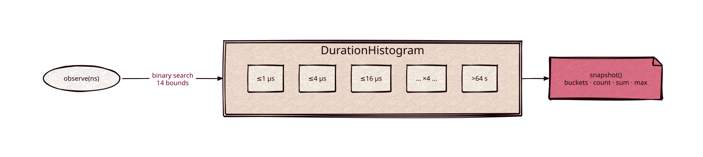

# metrics

Part of [Kronuz C++ Libraries](https://github.com/Kronuz/cpp-libraries), a collection of small, reusable C++ libraries.

[](https://github.com/Kronuz/metrics/actions/workflows/ci.yml)
[](LICENSE)


Bounded counters and duration histograms for C++20, header-only, with no dependencies.
Counters saturate instead of wrapping, and nothing allocates.



## ✨ Highlights

- `kronuz::metrics::Counter`: a single-owner `std::uint64_t` counter. `add(n)` saturates at
  the maximum instead of wrapping; `observe_max(v)` keeps the largest value seen.
- `kronuz::metrics::AtomicCounter`: the same with relaxed atomics, for counters several
  threads update.
- `kronuz::metrics::DurationHistogram<Counter>`: nanosecond durations in 15 buckets with
  inclusive bounds from 1 µs to 64 s, growing by 4× (the last bucket holds everything
  above 64 s), plus the count, the saturating sum, and the maximum.
  `AtomicDurationHistogram` uses `AtomicCounter`. `snapshot()` copies the state out as a
  plain `DurationSnapshot`.

Nothing allocates, and an update is a few instructions: the bucket is a binary search
over 14 constant bounds.

## 📦 Installation

Requires a C++20 compiler; CMake 3.14 or newer for the CMake route. CI builds it on
Linux (x86_64, arm64), macOS (arm64, x86_64), and FreeBSD, plus ASan, UBSan, and TSan
builds.

```cmake
include(FetchContent)
FetchContent_Declare(metrics
  GIT_REPOSITORY https://github.com/Kronuz/metrics.git
  GIT_TAG        main)
FetchContent_MakeAvailable(metrics)

target_link_libraries(my_app PRIVATE metrics::metrics)
```

## 🚀 Quick start

```cpp
#include "metrics.hh"

kronuz::metrics::DurationHistogram<> latency;
latency.observe(12'000);                 // 12 µs
auto s = latency.snapshot();             // s.buckets, s.count, s.sum_ns, s.maximum_ns
```

## 🛠️ Building and testing

```sh
cmake -S . -B build && cmake --build build && ctest --test-dir build
./build/metrics_bench
```

## 🎯 When to use it

- ✅ Hot-path counters and latency histograms with fixed memory.
- ❌ Exporting: snapshots are plain structs; formatting for Prometheus or similar is yours.

## 📚 Documentation

- [AGENTS.md](AGENTS.md): repository map and invariants.

## 🤝 Contributing

Issues and pull requests are welcome. Read [AGENTS.md](AGENTS.md) first. CI must
pass on every platform.

## 📄 License

MIT, Copyright (c) 2026 Germán Méndez Bravo. See [LICENSE](LICENSE).
